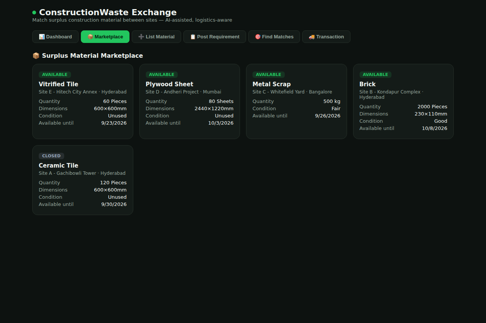
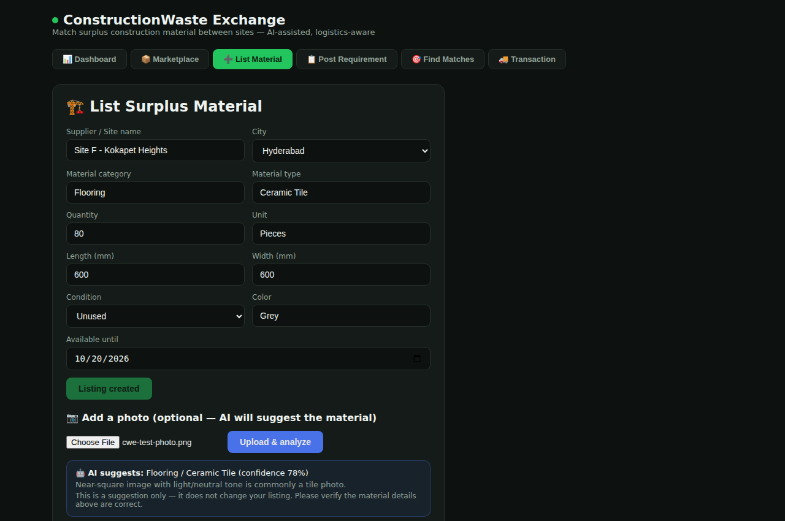
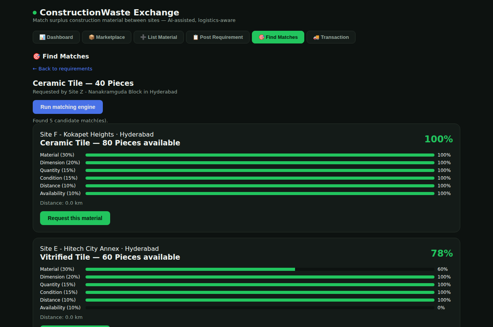
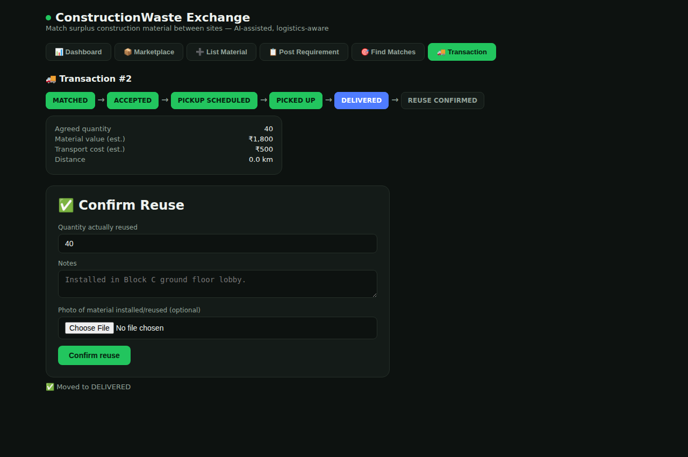
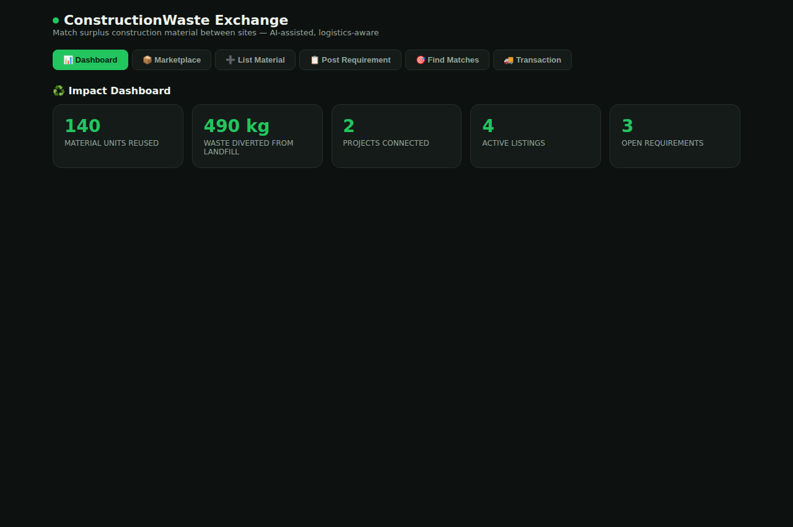
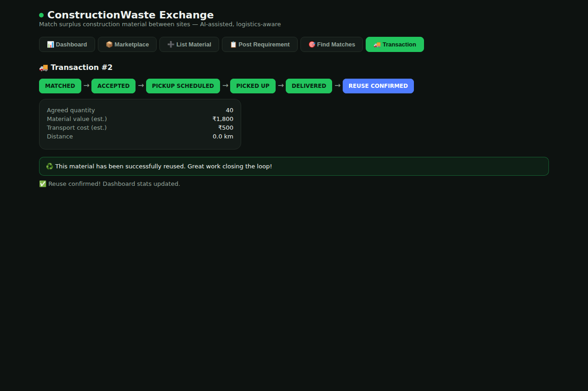

# Construction Material Exchange

**A marketplace that connects construction sites with leftover material to sites that need it.**

    

**Live app:** [site-surplus.vercel.app](https://site-surplus.vercel.app/) · **API:** [construction-waste-exchange-api.onrender.com](https://construction-waste-exchange-api.onrender.com/)

The API runs on a free tier, so the first request after a quiet period can take 30 to 60 seconds to wake up.

---

## Why this exists

Construction sites often end up with leftover tiles, bricks and plywood that get thrown away, while another site a few kilometres away is buying the same material new. This project tries to close that gap.

A site lists what it has. Another site posts what it needs. The app scores every available listing against the requirement, estimates the cost and distance of moving the material, and tracks the deal until the requester confirms the material was actually reused. A dashboard then shows how much waste was kept out of landfill.

I built it as a portfolio project. I wanted to work through a multi-entity data model, write a matching algorithm I could fully explain, enforce a state machine on the server, and connect it all to a clean React frontend.

## Screenshots

| Marketplace | Listing with AI photo analysis |
|---|---|
|  |  |

| Matches with score breakdown | Transaction lifecycle |
|---|---|
|  |  |

| Dashboard | Reuse confirmed |
|---|---|
|  |  |

More are in [`screenshots/`](screenshots/). A recorded walkthrough of the whole flow is in [`demo-video.mp4`](demo-video.mp4).

## How it works

1. A **supplier** lists surplus material. They can upload a photo, and the app suggests a material type from it. It's only a suggestion, and the user has to confirm it.
2. A **requester** posts what they need.
3. The **matching engine** scores every available listing on material, dimensions, quantity, condition, distance and availability. The score for each criterion is shown to the user.
4. For the top matches, the app calculates the distance between cities, an estimated transport cost and an estimated material value.
5. A **transaction** is created and moves through a fixed set of states: `MATCHED → ACCEPTED → PICKUP_SCHEDULED → PICKED_UP → DELIVERED → REUSE_CONFIRMED`. The backend rejects any invalid jump.
6. The requester **confirms reuse**, optionally with a photo, and the dashboard updates.

### A note on the "AI" parts

None of this uses an LLM, and that's deliberate. I wanted every step to be something I could test and explain.

| Step | What it actually is | File |
|---|---|---|
| Material from photo | A simple heuristic using colour and aspect ratio | `services/material_ai.py` |
| Reading descriptions like "600 sq tile" or "2x2 ceramic flooring" | Regex plus a lookup table | `services/normalization.py` |
| Matching | A weighted formula | `services/matching_engine.py` |

In a production version I'd replace the photo heuristic with a trained image classifier and the city lookup with a real geocoding and routing API.

## Features

- List surplus material with category, type, dimensions, quantity, condition, colour, city and availability window
- Photo upload with a suggested material type, confidence and reasoning
- Post requirements using the same structured fields
- Run the matching engine against any requirement and see the breakdown across all six criteria
- Distance (great-circle), transport cost and material value estimates
- Server-enforced transaction states, with a stepper in the UI
- Reuse confirmation with quantity, notes and an optional photo
- Impact dashboard (materials reused, waste diverted in kg, projects connected) calculated from confirmed transactions, not hardcoded

## Tech stack

| | |
|---|---|
| **Backend** | Python 3.12, FastAPI, SQLAlchemy, Pydantic v2 |
| **Database** | PostgreSQL, with SQLite for easy local setup |
| **Image processing** | Pillow |
| **Frontend** | React 18, Vite |
| **Containers** | Docker, Docker Compose |
| **Hosting** | Vercel (frontend), Render (backend and database) |

## How the matching works

Each listing gets a score between 0 and 1, made up of six weighted parts.

| Criterion | Weight | Scoring |
|---|---|---|
| Material | 30% | 1.0 for an exact type match, 0.6 if only the category matches, otherwise 0 |
| Dimension | 20% | 1.0 within 2% difference, falling linearly to 0 at 25% or more |
| Quantity | 15% | 1.0 if the listing has enough, otherwise available ÷ required |
| Condition | 15% | 1.0 if it meets or beats the required condition, lower if it doesn't |
| Distance | 10% | 1.0 at 0 km, falling linearly to 0 at 300 km |
| Availability | 10% | 1.0 if available before the required date, lower for each day late |

The 300 km cutoff is set by `MAX_USEFUL_DISTANCE_KM` and is easy to change for a different market. Each sub-score has its own unit test in `backend/tests/test_matching_engine.py`.

## Project structure

```
construction-waste-exchange/
├── backend/
│   ├── app/
│   │   ├── routers/         listings, requirements, matching, transactions, reuse, dashboard
│   │   ├── services/        material_ai, normalization, matching_engine, logistics, geodata
│   │   ├── models.py        SQLAlchemy models
│   │   ├── schemas.py       Pydantic schemas
│   │   ├── main.py          App setup
│   │   └── seed.py          Demo data
│   ├── tests/               31 pytest tests
│   └── Dockerfile
├── frontend/
│   ├── src/
│   │   ├── components/      Dashboard, Marketplace, forms, matches, transactions
│   │   └── api.js           API client
│   └── Dockerfile
├── docker-compose.yml
├── screenshots/
└── demo-video.mp4
```

## Running it

### Native

You need Python 3.10+ and Node.js 18+. It uses a local SQLite file, so there's no database to set up.

```bash
# Backend
cd backend
pip install -r requirements.txt
python -m app.seed          # loads demo data
uvicorn app.main:app --reload --port 8000

# Frontend, in a second terminal
cd frontend
npm install
npm run dev
```

Then open http://localhost:5173.

### Docker Compose

```bash
docker compose up --build
```

The frontend runs on http://localhost:3000 and the API on http://localhost:8000, with interactive docs at `/docs`. Demo data is seeded on first start: 5 listings, 2 requirements and one completed transaction.

## Tests

```bash
cd backend
pytest
```

The 31 tests cover description parsing, the matching engine, logistics and the photo classifier. As a sanity check on the distance maths, Hyderabad to Bangalore comes out at about 500 km, which matches the real figure.

## API

Swagger docs are generated at `/docs` when the backend is running.

| Method | Endpoint | What it does |
|---|---|---|
| POST | `/api/listings` | Create a listing |
| GET | `/api/listings?status=AVAILABLE` | List listings, optionally by status |
| POST | `/api/listings/{id}/images` | Upload a photo and get the material suggestion |
| POST | `/api/requirements` | Post a requirement |
| GET | `/api/requirements` | List requirements |
| POST | `/api/matching/run/{requirement_id}` | Score all available listings |
| GET | `/api/matching/for-requirement/{id}` | Get stored matches |
| POST | `/api/transactions` | Create a transaction from a match |
| PATCH | `/api/transactions/{id}/status` | Move a transaction to its next state |
| POST | `/api/reuse` | Confirm reuse (quantity, notes, optional photo) |
| GET | `/api/dashboard/stats` | Impact totals |

Example response from running the matching engine:

```bash
curl -X POST http://localhost:8000/api/matching/run/1
```

```json
[
  {
    "id": 4, "score": 0.80,
    "material_score": 0.6, "dimension_score": 1.0, "quantity_score": 1.0,
    "condition_score": 1.0, "distance_score": 1.0, "availability_score": 0.0,
    "distance_km": 0.0,
    "listing": { "material_type": "Vitrified Tile", "quantity": 60, "...": "..." }
  }
]
```

## Known limitations

- There are no user accounts. Supplier and requester names are free text.
- City coordinates come from a fixed lookup table, and distance is a straight line, not a road route.
- The photo classifier is a heuristic, not a trained model.
- Uploaded photos are stored on local disk. On the free Render tier that disk is wiped on every redeploy, so uploads don't persist in the live app.

## What I'd do next

- Real geocoding and road routing
- A trained image model for material identification
- Cloud storage (S3 or Cloudinary) for uploads
- User accounts and login
- Email or SMS alerts when a match is found or a status changes
- A model that predicts which surplus materials are likely to find a buyer soon, once there's enough transaction history

## License

MIT. See [LICENSE](LICENSE).
