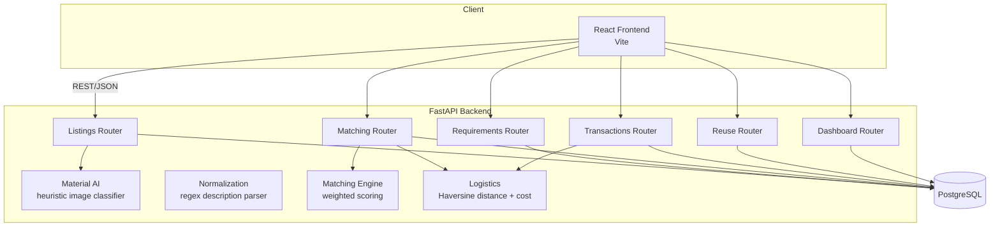

#  Construction Material Exchange

> Match surplus construction material between sites — AI-assisted material identification, a transparent weighted matching engine, real logistics estimation, and a full transaction lifecycle through to reuse confirmation.

A full-stack marketplace that connects construction sites with surplus material (tiles, bricks, plywood, metal scrap...) to sites that need it — reducing landfill waste and material costs on both sides.

    

## LIVE LINKS
**Vercel** - https://site-surplus.vercel.app/

**Render** - https://construction-waste-exchange-api.onrender.com/

---

## 📸 Screenshots

*(Real captures of the app running end-to-end — not mockups.)*

| Marketplace | List material + AI photo analysis |
|---|---|
|  |  |

| Matching engine with score breakdown | Transaction lifecycle |
|---|---|
|  |  |

| Dashboard | Reuse confirmed |
|---|---|
|  |  |

More in [`screenshots/`](screenshots/).

## 🎥 Demo Video

**[`demo-video.mp4`](demo-video.mp4)** — a real recorded walkthrough: browsing the marketplace, listing material with AI photo analysis, posting a requirement, running the matching engine, watching a transaction move through its full lifecycle, and confirming reuse. GitHub renders `.mp4` files inline when opened in the repo.

---

## 💡 About This Project

Construction sites routinely have surplus material (leftover tiles, bricks, plywood) that gets thrown away, while other nearby sites are buying the same material new. **Construction Material Exchange** closes that loop:

1. A **supplier** site lists surplus material — optionally uploading a photo that an AI heuristic analyzes to suggest the material type (shown as a *suggestion the user confirms*, never written automatically)
2. A **requester** site posts what they need
3. A **deterministic, auditable matching engine** scores every available listing against the requirement across material, dimensions, quantity, condition, distance, and availability — with the exact weights shown to the user, not a black box
4. **Logistics** (real great-circle distance, estimated transport cost, estimated material value) are calculated for the top matches
5. A **transaction** is created and walked through an explicit state machine (`MATCHED → ACCEPTED → PICKUP_SCHEDULED → PICKED_UP → DELIVERED → REUSE_CONFIRMED`) that rejects invalid transitions
6. The requester **confirms reuse** with a photo, and the impact dashboard updates with real diverted-waste numbers

Built as a portfolio project to demonstrate: designing a multi-entity relational data model, writing a transparent rules-based matching algorithm (not just calling an LLM), enforcing a state machine server-side, real geospatial math, and a clean React frontend consuming all of it.

### Where AI actually belongs (by design)

Per the project's own design principle: AI assists, it doesn't decide.

| Stage | What it does | What it is |
|---|---|---|
| Material ID from photo | Suggests category/type from an uploaded image | A heuristic (color + aspect ratio) the user must confirm — see `services/material_ai.py` |
| Description normalization | Parses `"600 sq tile"` / `"2x2 ceramic flooring"` into structured dimensions | Deterministic regex + lookup table — see `services/normalization.py` |
| Matching | Scores listings against requirements | A transparent weighted formula, **not** an LLM — see `services/matching_engine.py` |

None of these are LLM calls. They're documented, testable, auditable functions — with clear comments on exactly what you'd swap in (a trained CV classifier, a real geocoding/routing API) for a production version.

---

## 🏗️ Architecture



**Flow:** Supplier lists material → (optional) AI suggests material type from photo → Requester posts requirement → Matching engine scores all available listings → Logistics estimated for the chosen match → Transaction created and walked through its lifecycle → Reuse confirmed → Dashboard aggregates impact.

---

## 🧰 Tech Stack

| Layer | Technology | Why |
|---|---|---|
| Backend | Python 3.12, FastAPI, SQLAlchemy, Pydantic v2 | Async-ready, auto-generated OpenAPI docs, strong typing, a natural fit for the CV/AI pieces |
| Database | PostgreSQL (SQLite fallback for zero-config local dev) | Same code path either way — no branching logic needed |
| Image processing | Pillow | Real pixel analysis for the material-ID heuristic |
| Frontend | React 18, Vite | Fast dev loop, no router needed for this scope (tab-based SPA) |
| Containerization | Docker, docker-compose | One command spins up Postgres + backend + frontend together |
| Deployment | Vercel (frontend) + Render (backend + Postgres) | Both have generous free tiers and near-zero-config deploys for this stack |

---

## ✨ Features

- 📦 **List surplus material** with category, type, dimensions, quantity, condition, color, city, and availability window
- 🤖 **AI photo analysis** — upload a photo, get a suggested material category/type + confidence + reasoning (never auto-applied)
- 📋 **Post requirements** with the same structured fields
- 🎯 **Matching engine** — run it against any requirement, see every candidate listing's score broken down by all six weighted criteria
- 🚚 **Logistics estimation** — real Haversine distance between cities, estimated transport cost and material value
- 🔄 **Transaction lifecycle** — explicit state machine enforced server-side; the frontend shows a live stepper
- ♻️ **Reuse confirmation** — upload proof of installation/reuse with a quantity and notes
- 📊 **Impact dashboard** — materials reused, waste diverted (kg), projects connected — computed from real confirmed transactions, not hardcoded

---

## 📂 Project Structure

```
construction-waste-exchange/
├── backend/                       # FastAPI backend
│   ├── app/
│   │   ├── routers/                # listings, requirements, matching, transactions, reuse, dashboard
│   │   ├── services/
│   │   │   ├── material_ai.py       # heuristic image-based material classifier
│   │   │   ├── normalization.py     # regex description parser
│   │   │   ├── matching_engine.py   # weighted scoring algorithm
│   │   │   ├── logistics.py         # Haversine distance + cost estimation
│   │   │   └── geodata.py           # city -> lat/lon lookup
│   │   ├── models.py                # SQLAlchemy ORM models
│   │   ├── schemas.py               # Pydantic request/response schemas
│   │   ├── main.py                  # FastAPI app + CORS + static file serving
│   │   └── seed.py                  # demo data seed script
│   ├── tests/                       # pytest unit tests (31 tests)
│   ├── requirements.txt
│   ├── Dockerfile
│   └── .env.example
├── frontend/                       # React + Vite frontend
│   ├── src/
│   │   ├── components/               # Dashboard, Marketplace, ListingForm, RequirementForm, MatchesView, TransactionView
│   │   └── api.js                    # API client
│   ├── Dockerfile
│   ├── vercel.json
│   └── .env.example
├── docker-compose.yml               # Postgres + backend + frontend, one command
├── render.yaml                      # Render deployment blueprint
├── screenshots/
├── demo-video.mp4
└── README.md
```

---

## 🚀 Getting Started

### Option A — Docker Compose (recommended, one command)

Requires Docker + Docker Compose installed.

```bash
git clone https://github.com/<your-username>/construction-waste-exchange.git
cd construction-waste-exchange
docker compose up --build
```

- Backend API: **http://localhost:8000** (docs at `/docs`)
- Frontend: **http://localhost:3000**
- Postgres: `localhost:5432` (user `cwe` / password `cwe_password` / db `construction_waste_exchange`)

The backend automatically seeds demo data (5 listings, 2 requirements, a completed reuse-confirmed transaction) on first boot.

> **Note:** this project was built and tested in a sandboxed environment without Docker installed, so the `Dockerfile`s and `docker-compose.yml` are written correctly against standard patterns but weren't build-tested here. Everything they run (the FastAPI app, the Vite build) *was* tested directly — see "What was actually tested" below. Run `docker compose up --build` locally as your first real test of the container layer.

### Option B — Run natively (no Docker)

**Prerequisites:** Python 3.10+, Node.js 18+

```bash
# 1. Backend (zero-config: uses a local SQLite file)
cd backend
pip install -r requirements.txt
python -m app.seed          # populate demo data
uvicorn app.main:app --reload --port 8000

# 2. Frontend (in a new terminal)
cd frontend
npm install
npm run dev
```

Open **http://localhost:5173**.

---

## 🔌 API Reference

Full interactive docs (Swagger UI) are auto-generated at **`/docs`** once the backend is running.

| Method | Endpoint | Description |
|---|---|---|
| POST | `/api/listings` | Create a listing |
| GET | `/api/listings?status=AVAILABLE` | List listings, optionally filtered by status |
| POST | `/api/listings/{id}/images` | Upload a photo — runs the AI material classifier and returns its suggestion |
| POST | `/api/requirements` | Post a requirement |
| GET | `/api/requirements` | List all requirements |
| POST | `/api/matching/run/{requirement_id}` | Run the matching engine against all available listings |
| GET | `/api/matching/for-requirement/{id}` | Get previously computed matches |
| POST | `/api/transactions` | Create a transaction from a match (computes logistics estimate) |
| PATCH | `/api/transactions/{id}/status` | Advance the transaction state machine (rejects invalid transitions) |
| POST | `/api/reuse` | Confirm reuse (multipart form: quantity, notes, optional photo) |
| GET | `/api/dashboard/stats` | Aggregate impact numbers |

**Example — run the matching engine:**
```bash
curl -X POST http://localhost:8000/api/matching/run/1
```
```json
[
  {
    "id": 4, "score": 0.80,
    "material_score": 0.6, "dimension_score": 1.0, "quantity_score": 1.0,
    "condition_score": 1.0, "distance_score": 1.0, "availability_score": 0.0,
    "distance_km": 0.0,
    "listing": { "material_type": "Vitrified Tile", "quantity": 60, "...": "..." }
  }
]
```

---

## 🧠 How the Matching Engine Works

Per the project's design principle, this is a **transparent weighted formula**, not an LLM or opaque model — every score can be explained field-by-field:

| Criterion | Weight | How it's scored |
|---|---|---|
| Material | 30% | 1.0 if exact type match, 0.6 if only category matches, else 0.0 |
| Dimension | 20% | 1.0 within 2% difference, scaling linearly to 0.0 at 25%+ difference |
| Quantity | 15% | 1.0 if listing has enough, else proportional (`available / required`) |
| Condition | 15% | 1.0 if listing's condition meets or exceeds what's required, degrading below |
| Distance | 10% | 1.0 at 0km, linearly to 0.0 at 300km (tune `MAX_USEFUL_DISTANCE_KM` for your market) |
| Availability | 10% | 1.0 if available before the required date, degrading per day late |

See `backend/app/services/matching_engine.py` — every sub-score function is independently unit tested in `backend/tests/test_matching_engine.py`.

---

## ✅ What Was Actually Tested

Being specific about what's verified vs. what follows standard patterns but wasn't run in this environment:

**Verified working, live, in this environment:**
- All 31 backend pytest unit tests pass (`normalization`, `matching_engine`, `logistics`, `material_ai`)
- The Haversine distance function checked against a known real-world distance (Hyderabad↔Bangalore: computed 499.99km vs real ~500km)
- The full FastAPI backend run live and exercised end-to-end over HTTP: creating listings/requirements, uploading real images and getting AI predictions back, running the matching engine, walking a transaction through its full state machine (including a rejected illegal transition), confirming reuse, and checking the dashboard aggregate correctly
- The React frontend builds clean with `npm run build` (zero errors)
- The **entire user flow end-to-end through a real browser** (Playwright + Chromium): browsing the marketplace, filling and submitting the listing form, uploading a photo and getting a live AI prediction rendered in the UI, posting a requirement, running the matching engine and seeing the score breakdown render, creating a transaction, advancing it through every state, confirming reuse with a photo, and seeing the dashboard update — all captured as the real screenshots and video in this README

**Written to standard patterns, not build-tested here (no Docker in this sandbox):**
- `backend/Dockerfile`, `frontend/Dockerfile`, `docker-compose.yml` — run `docker compose up --build` locally as your first test
- `render.yaml` — Render blueprint syntax; verify against Render's current blueprint schema at deploy time

---

## ☁️ Deploying Live (Vercel + Render)

### Backend → Render

1. Push this repo to GitHub.
2. In Render, choose **New → Blueprint**, point it at your repo — it will read `render.yaml` and provision a **web service** (FastAPI) and a **free Postgres database**, wiring `DATABASE_URL` automatically.
3. Once deployed, note the backend's URL (e.g. `https://construction-waste-exchange-api.onrender.com`).
4. Update `CORS_ORIGINS` in the Render service's environment variables to include your Vercel frontend URL once you have it (step below), then redeploy.

> **Free-tier note:** Render's free web services spin down after inactivity (cold starts of ~30-60s) and use **ephemeral disk** — uploaded photos in `/static/uploads` won't survive a redeploy. For a real deployment, swap local file storage for S3/Cloudinary (a few lines in `routers/listings.py` and `routers/reuse.py`) or upgrade to a Render persistent disk.

### Frontend → Vercel

1. In Vercel, **Add New → Project**, import this repo, and set the **root directory to `frontend`**.
2. Vercel auto-detects Vite via `vercel.json`. Add an environment variable:
   - `VITE_API_BASE_URL` = your Render backend URL from above
3. Deploy. Vercel gives you a live URL (e.g. `https://construction-waste-exchange.vercel.app`).
4. Go back to Render and set `CORS_ORIGINS` to include this Vercel URL, then redeploy the backend so it accepts requests from it.

### Local Docker Compose vs. live deployment

The same `backend`/`frontend` code runs in all three environments (native, docker-compose, Vercel+Render) — only `DATABASE_URL`, `CORS_ORIGINS`, and `VITE_API_BASE_URL` change between them.

---

## 🔭 Future Work

- Real geocoding (Google Maps / Mapbox Geocoding API) instead of the fixed city lookup table, and a real routing API for road distance instead of great-circle distance
- Swap the heuristic material classifier for a trained CV model (fine-tuned ResNet/EfficientNet, or a hosted vision API)
- S3/Cloudinary for uploaded images instead of local disk (needed for Render's ephemeral filesystem)
- User accounts + authentication (currently supplier/requester names are free text, no login)
- Email/SMS notifications on match found, status changes
- An ML model predicting "which surplus materials are likely to find a buyer soon" (a legitimate ML problem once there's enough transaction history — see the project's own design note on this)

---

## 📄 License

MIT — see [LICENSE](LICENSE).
